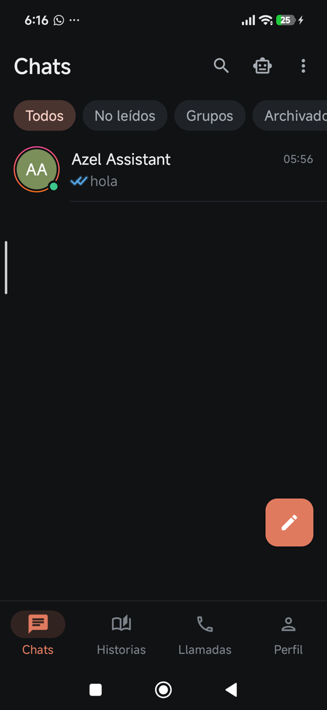
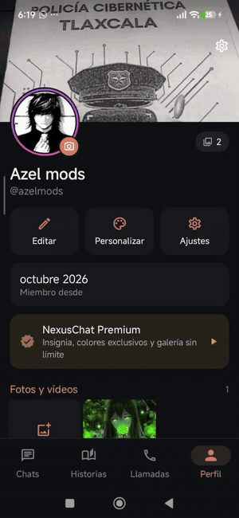
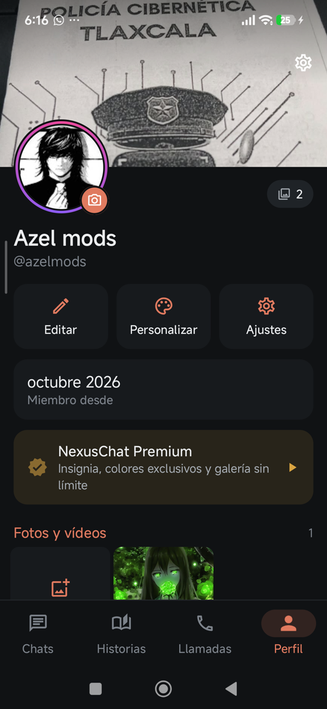
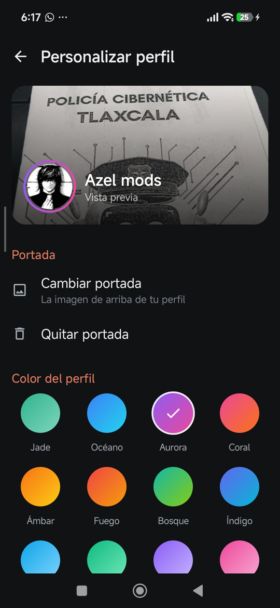
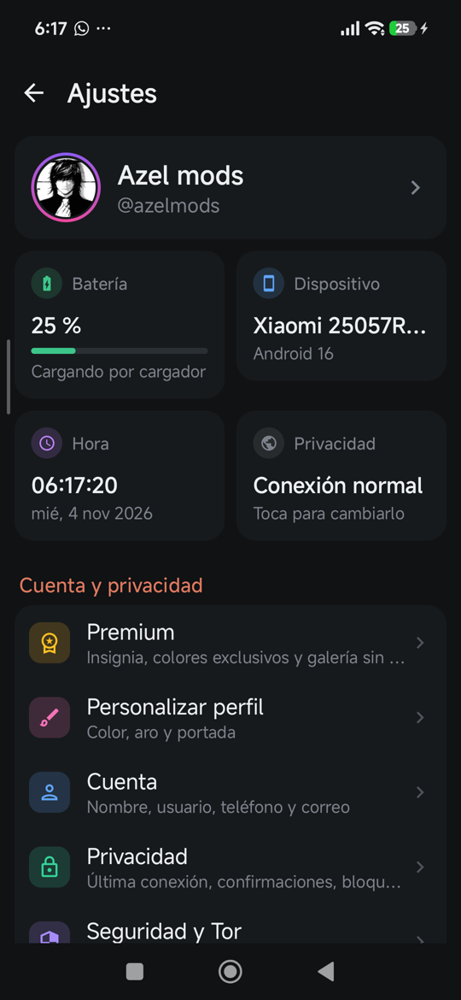
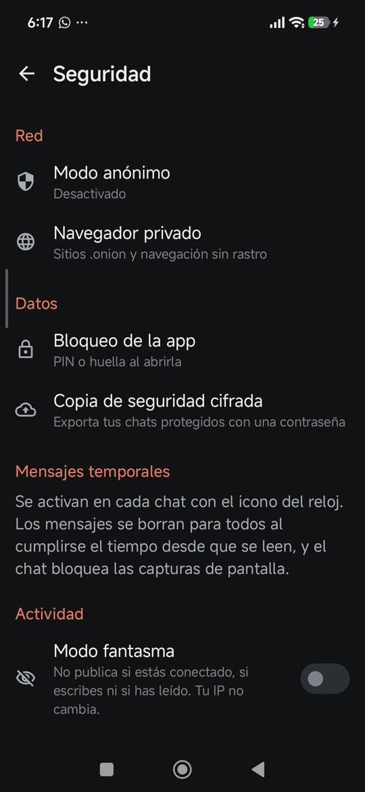

<p align="center">
  
</p>

<p align="center">
  <a href="https://github.com/Azelmods677/NexusChat/releases/latest"></a>
  
  
  
</p>

<p align="center">
  
</p>

**NexusChat** redefine lo que puede hacer una app de mensajería. En un solo lugar reúne chats privados, llamadas de voz y vídeo, historias, un equipo de agentes de inteligencia artificial que trabaja por ti, navegación anónima con Tor integrado y un entorno de programación con terminal real.

Diseñada para quien quiere más de su teléfono: una experiencia cuidada al detalle, sin anuncios y con código abierto.

<p align="center">
  <a href="https://github.com/Azelmods677/NexusChat/releases/latest"><strong>⬇️ Descargar NexusChat</strong></a>
  &nbsp;·&nbsp;
  <a href="#así-se-ve">Ver cómo se ve</a>
  &nbsp;·&nbsp;
  <a href="#qué-puedes-hacer">Qué puedes hacer</a>
  &nbsp;·&nbsp;
  <a href="#instalarla">Instalarla</a>
  &nbsp;·&nbsp;
  <a href="#english">English</a>
</p>

---

## Así se ve

<p align="center">
  <em>Grabado en un teléfono real, sin retoques.</em>
</p>

<table>
<tr>
<td align="center" width="25%"><br><strong>La entrada</strong><br><sub>Puntos que se conectan y forman el emblema</sub></td>
<td align="center" width="25%"><br><strong>Tus chats</strong><br><sub>Aros de color y animaciones que responden al dedo</sub></td>
<td align="center" width="25%"><br><strong>Perfiles con vida</strong><br><sub>Tus fotos y vídeos a pantalla completa</sub></td>
<td align="center" width="25%"><br><strong>Agentes en directo</strong><br><sub>Míralos pensar, buscar y escribir</sub></td>
</tr>
</table>

---

## Qué puedes hacer

<table>
<tr>
<td width="50%"></td>
<td width="50%"></td>
</tr>
<tr>
<td></td>
<td></td>
</tr>
<tr>
<td></td>
<td></td>
</tr>
<tr>
<td></td>
<td></td>
</tr>
</table>

---

## Agentes que hacen el trabajo

La mayoría de los asistentes te dan una respuesta y te dejan el resto a ti. Los agentes de NexusChat **toman un objetivo y lo llevan hasta el final**: buscan, leen, escriben código, lo ejecutan, ven si falla, lo corrigen y te entregan el resultado. Y lo ves pasar en directo.

<p align="center">
  
</p>

<table>
<tr>
<td width="62%" valign="top">

**Pídeles cosas como estas:**

- *"Crea una página web de tareas en HTML y guárdala en mis archivos."*
- *"Escribe en Python un programa que valide contraseñas, pruébalo y guárdalo."*
- *"¿Qué se encuentra en internet sobre este nombre de usuario?"*
- *"Compara los 3 móviles más recomendados este año y dime cuál comprar."*
- *"Planifica un viaje de 4 días a Cartagena con presupuesto en pesos."*

**Lo que los hace distintos:**

- **Programan de verdad.** Ejecutan el código en 15 lenguajes, leen el error y lo arreglan antes de dártelo. Lo que escriben aparece en tu editor, listo para abrir.
- **Buscan a fondo.** Consultan Google, DuckDuckGo, Bing y Yahoo a la vez, abren las fuentes y citan de dónde sale cada dato. Si no encuentran algo, te dicen dónde buscaron en lugar de inventárselo.
- **Trabajan en equipo.** Un coordinador reparte las tareas entre especialistas: arquitecto, programador, probador, investigador, analista, redactor y más.
- **Usan tu IA.** Gemini, OpenAI, OpenRouter, DeepSeek, Groq, Mistral o un modelo en tu propio ordenador. Tú eliges, y tu clave se guarda cifrada en el teléfono.

</td>
<td width="38%" align="center" valign="top">

</td>
</tr>
</table>

---

## Tu perfil, a tu estilo

<table>
<tr>
<td width="33%" align="center"><br><strong>Fotos y vídeos a pantalla completa</strong><br><sub>Desliza entre ellos, en tu perfil y en el de los demás. Con un vídeo en la portada o como foto principal, tu perfil cobra vida.</sub></td>
<td width="33%" align="center"><br><strong>Personalízalo sin desordenarlo</strong><br><sub>40 colores y tu portada en una pantalla propia, con vista previa en directo.</sub></td>
<td width="33%" align="center"><br><strong>Ajustes tipo tablero</strong><br><sub>Batería, dispositivo, hora y privacidad de un vistazo, con todo bien agrupado.</sub></td>
</tr>
</table>

---

## Hablar, llamar y compartir

<table>
<tr>
<td width="33%" align="center" valign="top"><strong>Chats completos</strong><br><sub>Reacciones, respuestas, notas de voz, GIF, stickers, traducción, búsqueda, mensajes temporales y de una sola vista.</sub></td>
<td width="33%" align="center" valign="top"><strong>Llamadas directas</strong><br><sub>Voz y vídeo entre teléfonos, en pantalla completa. Con el modo anónimo, el otro no ve tu IP.</sub></td>
<td width="33%" align="center"><br><strong>Privacidad a mano</strong><br><sub>Modo anónimo, modo fantasma, bloqueo con huella o PIN, verificación en dos pasos y copias cifradas.</sub></td>
</tr>
</table>

---

## Privacidad desde el diseño

- 🔒 **Conversaciones protegidas.** Los chats de dos personas se cifran de extremo a extremo, y la clave privada nunca sale de tu teléfono.
- 🧅 **Tor integrado.** Navega y conéctate de forma anónima, sin instalar nada más.
- 🔑 **Tu IA, tus claves.** Se guardan cifradas en tu teléfono y las peticiones van directas al proveedor que elijas.
- 🚫 **Sin anuncios.** Ninguno, y no se venden tus datos.
- 🌐 **Código abierto.** Cualquiera puede revisar cómo funciona.

---

## Premium

NexusChat es gratis y lo seguirá siendo. Premium es para quien quiere personalizar más y apoyar el proyecto:

- ✨ **Insignia** junto a tu nombre.
- 🎨 **16 colores exclusivos** para tu perfil, como Galaxia, Arcoíris y Oro, además de los 24 que tiene todo el mundo.
- 🖼️ **Galería sin límite** de fotos y vídeos de perfil (10 sin Premium).

El pago se hace en la web de **Mercado Pago**: NexusChat nunca ve tu tarjeta, y Premium se activa solo en cuanto se confirma.

---

## Instalarla

1. Descarga el APK desde [la última versión](https://github.com/Azelmods677/NexusChat/releases/latest). Si no sabes cuál elegir, usa **arm64**: es el de casi todos los teléfonos actuales.
2. Ábrelo y permite la instalación desde esa fuente cuando Android lo pida.
3. Crea tu cuenta con correo, Google o tu número de teléfono.

Necesitas Android 12 o superior.

> **Consejo para Xiaomi, Redmi, POCO, Huawei u Oppo:** para recibir tus avisos al instante, activa **Inicio automático** para NexusChat y pon su batería **Sin restricciones** en los ajustes del teléfono.

---

## Preguntas frecuentes

<details>
<summary><strong>¿Es gratis?</strong></summary>
<br>
Sí. Premium es opcional y no bloquea ninguna función de mensajería. Las funciones de IA usan tu propia clave del proveedor que elijas, o ninguna si usas un modelo local.
</details>

<details>
<summary><strong>¿Qué necesito para usar los agentes?</strong></summary>
<br>
Una clave de un proveedor de IA. La de Google Gemini tiene un plan gratuito y además permite buscar en Google. Se configura en Ajustes → Inteligencia artificial.
</details>

<details>
<summary><strong>¿Los agentes pueden tocar mis datos?</strong></summary>
<br>
No acceden a tus chats. Pueden crear archivos en tu editor de código, pero nunca sobrescriben los que ya tenías: guardan una copia con otro nombre. El JavaScript se ejecuta aislado en tu teléfono, y el código en otros lenguajes en un servidor externo.
</details>

<details>
<summary><strong>¿Necesito instalar Orbot para usar Tor?</strong></summary>
<br>
No. Tor viene dentro de la app: se activa desde Ajustes → Seguridad y Tor.
</details>

---

<details>
<summary><strong>Para desarrolladores</strong></summary>

<br>

Android nativo con **Kotlin** y **Jetpack Compose**, arquitectura MVVM, **Firebase** (Auth, Realtime Database, Storage, Cloud Messaging, Cloud Functions), **WebRTC** para las llamadas y Tor integrado. El cifrado de los chats usa ECDH P-256 y AES-256-GCM.

**Compilar:**

```bash
git clone https://github.com/Azelmods677/NexusChat.git
cd NexusChat
# Coloca tu google-services.json en app/
./gradlew assembleDebug
```

**Desplegar el servidor en tu proyecto de Firebase:**

```bash
npx firebase-tools login
npx firebase-tools deploy --only database,storage
cd functions && npm ci && cd ..
npx firebase-tools functions:secrets:set MERCADOPAGO_ACCESS_TOKEN
npx firebase-tools deploy --only functions
```

Las notificaciones, el borrado automático y los pagos dependen de las Cloud Functions, que requieren el plan Blaze. Los precios de Premium están en `functions/index.js` y se pueden cambiar sin desplegar en `config/premium` de la base de datos.

**Llamadas:** sin configuración usan servidores STUN públicos. Para producción, pon tu propio TURN en `config/webrtc/iceServers`.

Más detalles en [docs/SETUP.md](docs/SETUP.md) y [CHANGELOG.md](CHANGELOG.md).

</details>

---

## English

**NexusChat** is an Android messenger that brings together private end-to-end encrypted chats, voice and video calls, stories, a team of AI agents that research, write and run code for you, built-in Tor, and a code editor with a real terminal. It's ad-free, open source and made by a single developer. The app is available in Spanish and English.

[Download the latest version](https://github.com/Azelmods677/NexusChat/releases/latest) · Requires Android 12 or later.

---

## El autor

<p align="center">
  NexusChat está diseñada y desarrollada por <a href="https://github.com/Azelmods677"><strong>Azel Mods</strong></a>.<br><br>
  <a href="https://t.me/AzelModsx7779"></a>
  <a href="https://youtube.com/@AzelModsx677"></a>
  <a href="https://tiktok.com/@azelmods677"></a>
  <br><br>
  <sub>Licencia <a href="LICENSE">MIT</a>: úsala, estúdiala y construye sobre ella conservando la atribución al autor.</sub>
</p>
