<p align="center">
  
</p>

<p align="center">
  <a href="https://github.com/Azelmods677/NexusChat/releases/latest"></a>
  
  
  
</p>

<p align="center">
  
</p>

<h3 align="center">Una sola app. Todo lo que esperas de un mensajero, y todo lo que nunca te dejaron cambiar.</h3>

<p align="center">
  <strong>NexusChat 8</strong> reúne chats cifrados, llamadas, historias, agentes de inteligencia artificial, Tor y una terminal con Kali Linux.<br>
  Y la envuelve en un estudio de diseño para que la tuya no se parezca a la de nadie.
</p>

<p align="center">
  <a href="https://github.com/Azelmods677/NexusChat/releases/latest"><strong>⬇️ Descargar</strong></a>
  &nbsp;·&nbsp;
  <a href="#novedades-de-la-8">Novedades</a>
  &nbsp;·&nbsp;
  <a href="#por-qué-nexuschat">Por qué NexusChat</a>
  &nbsp;·&nbsp;
  <a href="#el-estudio-de-diseño">Estudio de diseño</a>
  &nbsp;·&nbsp;
  <a href="#todo-lo-que-trae">Todo lo que trae</a>
  &nbsp;·&nbsp;
  <a href="#instálala-en-un-minuto">Instalar</a>
  &nbsp;·&nbsp;
  <a href="#english">English</a>
</p>

<p align="center">
  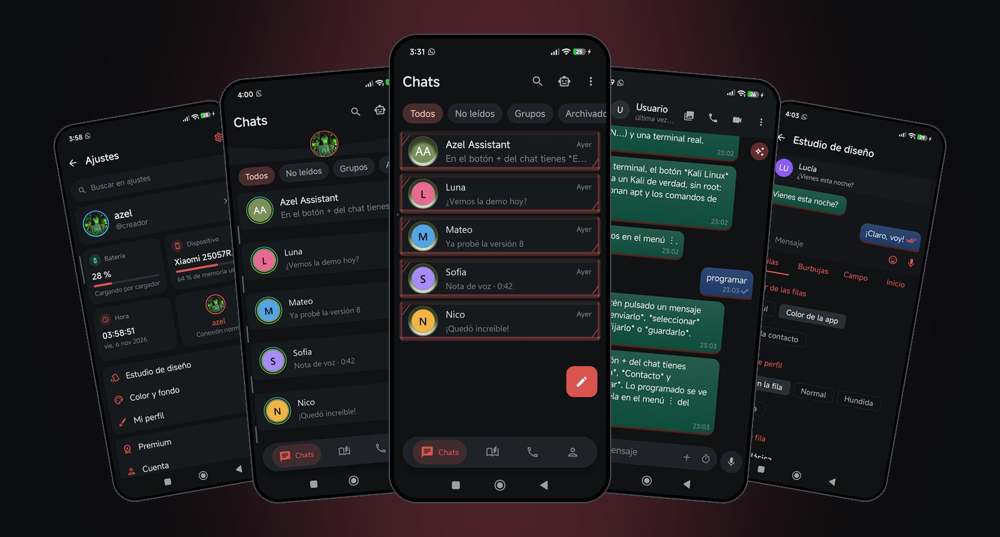
</p>

<p align="center">
  
</p>

---

## Novedades de la 8

La 8 es la actualización en la que NexusChat deja de tener un aspecto y pasa a tener **el tuyo**. Cada cambio se aplica al momento, sin reiniciar y sin perder nada.

<table>
<tr>
<td align="center" width="25%">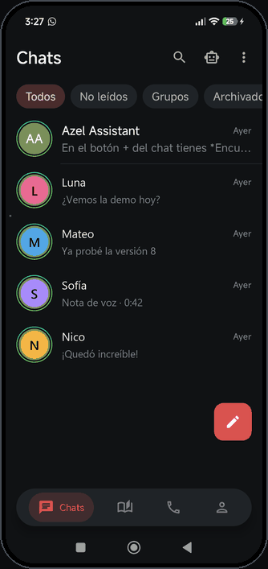<br><strong>Filas</strong><br><sub>Del 3D al neón, con la foto hundida o en esfera</sub></td>
<td align="center" width="25%">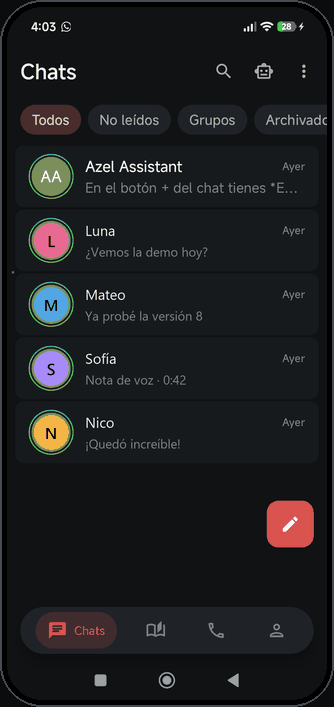<br><strong>Inicio</strong><br><sub>Tu foto, tu nombre, tu portada o una curva</sub></td>
<td align="center" width="25%">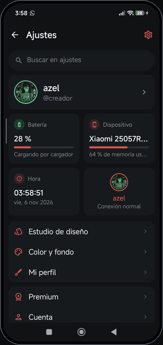<br><strong>Ajustes</strong><br><sub>Panel en vivo, tarjetas, lista o cuadrícula</sub></td>
<td align="center" width="25%">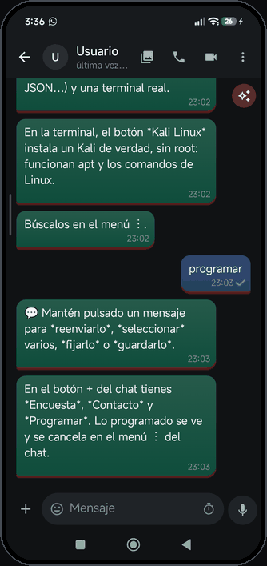<br><strong>Campo de escribir</strong><br><sub>Con tu foto, social, plano, 3D y más</sub></td>
</tr>
</table>

- 🎨 **Estudio de diseño:** filas, burbujas, marcas de lectura, campo de escribir, inicio, ajustes y 8 barras inferiores, con vista previa.
- 🔐 **Grupos cifrados y chats secretos:** grupos de extremo a extremo con administradores y enlace de invitación, y chats secretos con una clave nueva en cada mensaje.
- 🎬 **Perfiles en vídeo:** foto y portada en movimiento de hasta 1 minuto y 30 segundos.
- ⚡ **Funciones rápidas:** un panel dentro del chat con los atajos a mano.
- 🗂️ **Chats a tu orden:** carpetas, chats ocultos tras tu huella, mensajes programados, marcar como no leído y exportar un chat a texto.
- 💬 **Conversaciones más claras:** respuestas con el nombre de quien escribió, etiqueta de reenviado, texto en fotos y vídeos, y notas de voz distintas de los audios.
- 😀 **Stickers junto a los emojis:** con favoritos, y también para responder historias.
- 👥 **Grupos con foto y descripción.**
- ⭕ **Aro animado en el campo de escribir:** tu foto dentro de un aro que gira y responde al toque.
- 🛡️ **Comunidad segura:** reporta usuarios desde su chat y consulta la política de privacidad dentro de la app.
- 📥 **Descargador de vídeos renovado:** se actualiza solo y reintenta si una web cambia.
- 🐉 **Kali Linux de verdad** dentro de la terminal.
- 🔠 **21 tipos de letra** para toda la app y **36 colores de acento**, o escribe el tuyo en hexadecimal.

---

## Por qué NexusChat

| | NexusChat | WhatsApp | Telegram | Signal |
|---|:---:|:---:|:---:|:---:|
| Cifrado de extremo a extremo en chats y grupos | ✅ | ✅ | Solo chats secretos | ✅ |
| Diseñar filas, campo, inicio, ajustes y barras | ✅ | ❌ | Solo temas | ❌ |
| Tor integrado | ✅ | Solo proxy | Solo proxy | Solo proxy |
| Agentes de IA con tu propia clave | ✅ | Meta AI, sin elegir proveedor | Bots de terceros | ❌ |
| Terminal y Kali Linux | ✅ | ❌ | ❌ | ❌ |

<sub>Comparativa de funciones a noviembre de 2026. NexusChat está disponible por ahora solo para Android.</sub>

---

## El estudio de diseño

<table>
<tr>
<td width="38%" align="center">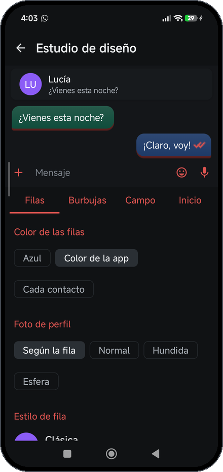</td>
<td width="62%" valign="middle">

### No son temas. Es tu app.

Otros mensajeros te dejan cambiar el fondo. Aquí eliges **cómo se construye cada pantalla**.

- **Cada opción con su miniatura:** ves lo que hace antes de elegirla.
- **Efecto de relieve real:** biseles, foto hundida y tarjetas 3D con canto que se inclinan al tocarlas.
- **Tu color en todas partes:** el acento se aplica a botones, filas, iconos y barras.
- **Búsqueda en ajustes:** escribe lo que buscas y llega al instante.

</td>
</tr>
</table>

### 10 filas de chat

<p align="center">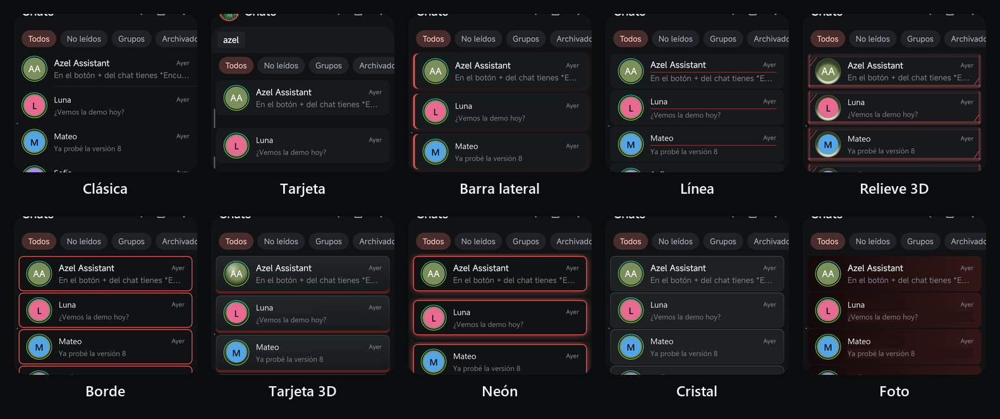</p>

### 12 campos de escribir

<p align="center">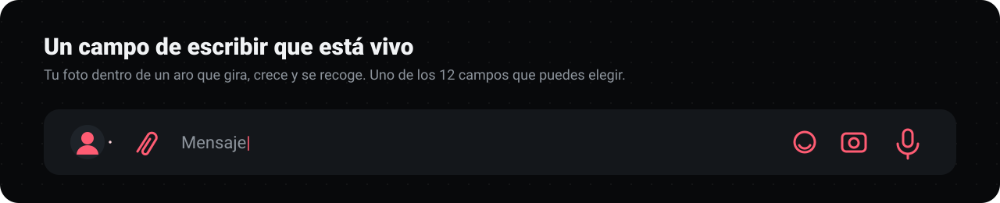</p>

<p align="center">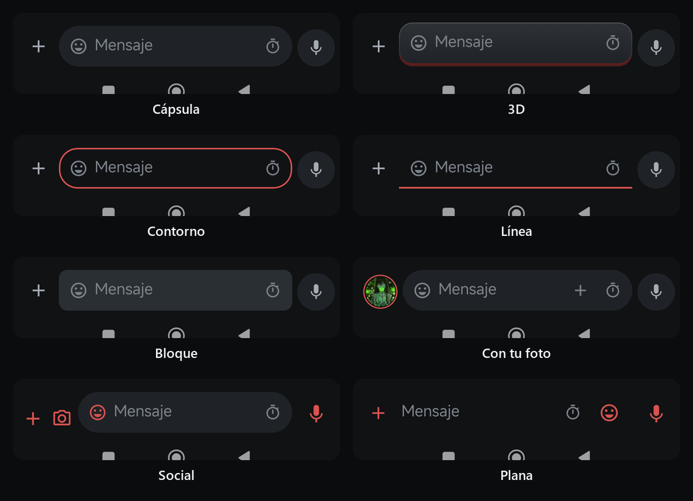</p>

<p align="center"><sub>Además de estos ocho: foto con aro animado, foto cuadrada, cápsula central y marco con línea.</sub></p>

### 7 pantallas de inicio

<p align="center">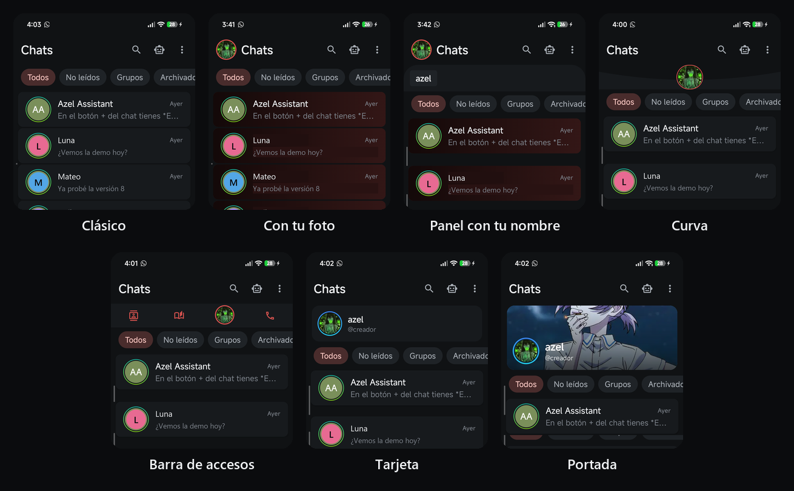</p>

### 8 barras inferiores

<p align="center">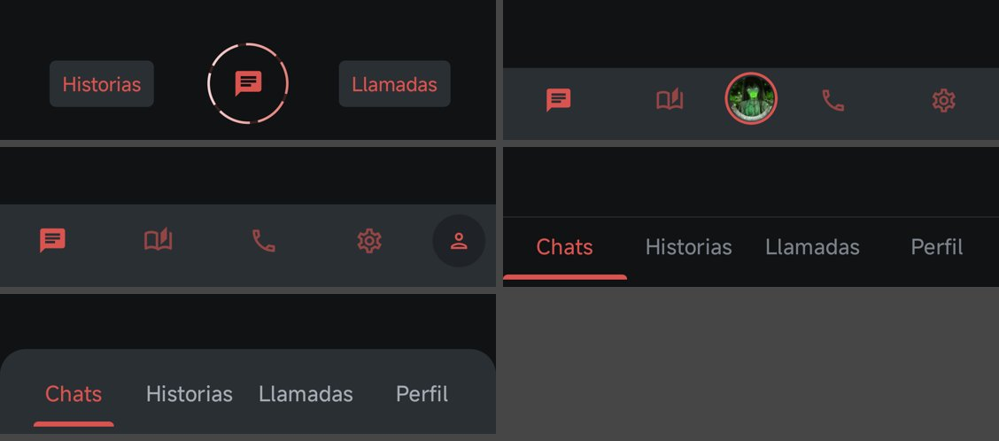</p>

### 7 pantallas de ajustes

<p align="center">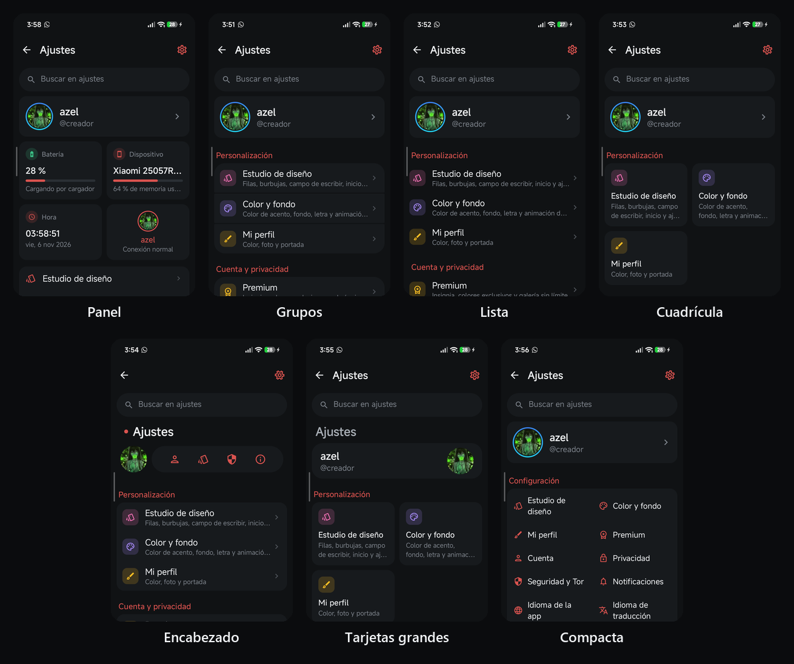</p>

---

## Todo lo que trae

<table>
<tr>
<td width="50%"></td>
<td width="50%"></td>
</tr>
<tr>
<td>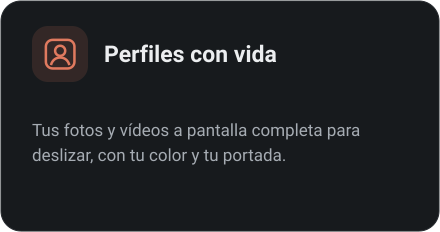</td>
<td></td>
</tr>
<tr>
<td>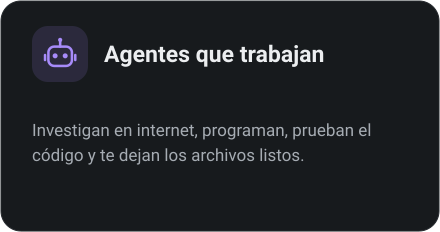</td>
<td>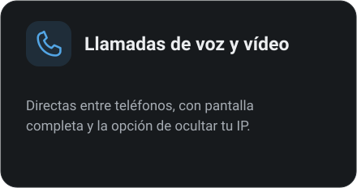</td>
</tr>
<tr>
<td>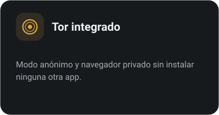</td>
<td></td>
</tr>
</table>

---

## Privacidad que se nota

<p align="center">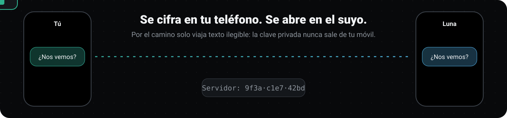</p>

<table>
<tr>
<td width="30%" align="center">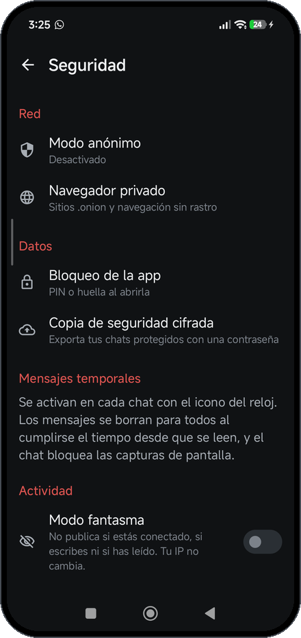</td>
<td width="70%" valign="middle">

- 🔒 **Cifrado de extremo a extremo** en chats y grupos. La clave privada nunca sale de tu teléfono.
- 🕵️ **Chats secretos** con una clave nueva en cada mensaje.
- 🧅 **Tor integrado** para navegar y conectarte de forma anónima, sin instalar nada más.
- 👻 **Modo fantasma:** no publica si estás conectado, si escribes ni si has leído.
- 🫣 **Chats ocultos** tras tu huella y **bloqueo de la app** con PIN o huella.
- ⏳ **Mensajes temporales** y de una sola vista.
- 💾 **Copias de seguridad cifradas** con tu contraseña.
- 🚫 **Sin anuncios.** Ninguno.

</td>
</tr>
</table>

---

## Agentes que hacen el trabajo

Le das un objetivo y **lo llevan hasta el final**: buscan, leen, programan, ejecutan, ven si falla, lo corrigen y te entregan el resultado. Y lo ves pasar en directo.

<p align="center"></p>

<table>
<tr>
<td width="62%" valign="top">

**Pídeles cosas como estas:**

- *"Crea una página web de tareas en HTML y guárdala en mis archivos."*
- *"Escribe en Python un programa que valide contraseñas, pruébalo y guárdalo."*
- *"Compara los 3 móviles más recomendados este año y dime cuál comprar."*
- *"Planifica un viaje de 4 días a Cartagena con presupuesto en pesos."*

**Lo que los hace distintos:**

- **Programan de verdad.** Ejecutan el código en 15 lenguajes, leen el error y lo arreglan antes de dártelo.
- **Buscan a fondo.** Consultan varios buscadores, abren las fuentes y citan de dónde sale cada dato.
- **Trabajan en equipo.** Un coordinador reparte las tareas entre arquitecto, programador, probador, investigador, analista y redactor.
- **Usan tu IA.** Gemini, OpenAI, OpenRouter, DeepSeek, Groq, Mistral o un modelo en tu ordenador. Tu clave se guarda cifrada en el teléfono.

</td>
<td width="38%" align="center" valign="top">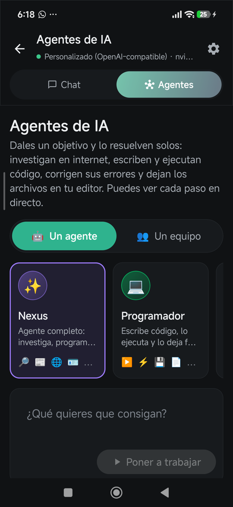</td>
</tr>
</table>

---

## Mucho más que un chat

<table>
<tr>
<td align="center" width="33%" valign="top">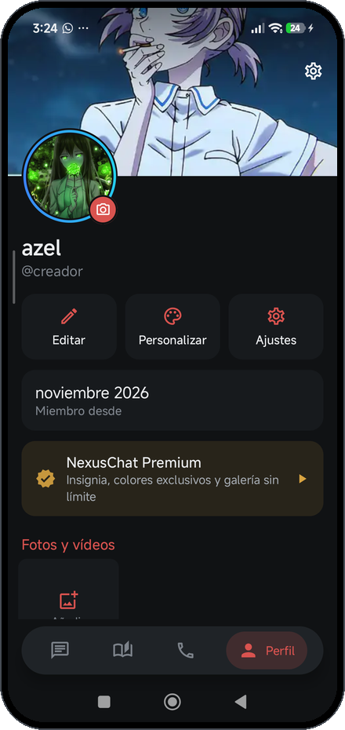<br><strong>Tu perfil, tu escaparate</strong><br><sub>Portada, foto en vídeo, galería a pantalla completa y 40 colores.</sub></td>
<td align="center" width="33%" valign="top">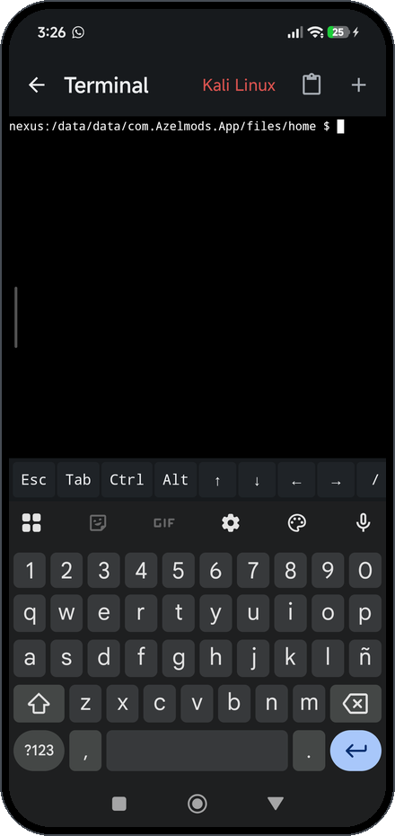<br><strong>Terminal de verdad</strong><br><sub>El shell de tu teléfono y Kali Linux, sin salir de la app.</sub></td>
<td align="center" width="33%" valign="top">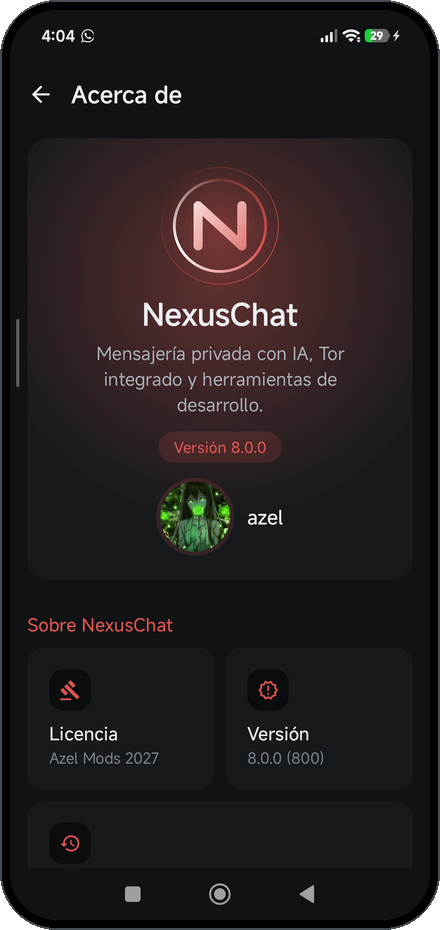<br><strong>Cuidada hasta el final</strong><br><sub>Hasta la pantalla de información tiene su propio diseño.</sub></td>
</tr>
</table>

**Y además:** reacciones, respuestas, reenviar y seleccionar varios mensajes, encuestas, canales, mensajes fijados y guardados, notas de voz, GIF, stickers propios y animados, vista previa de enlaces, menciones, compartir contactos, traducción y descarga de vídeos.

---

## Instálala en un minuto

1. Descarga el APK desde [la última versión](https://github.com/Azelmods677/NexusChat/releases/latest). Es uno solo y funciona en todos los teléfonos.
2. Ábrelo y permite la instalación desde esa fuente cuando Android lo pida.
3. Entra con tu correo, Google o tu número de teléfono.

Funciona en Android 12 o superior. Cuando sale una versión nueva, la propia app te avisa.

> **Consejo para Xiaomi, Redmi, POCO, Huawei u Oppo:** para recibir tus avisos al instante, activa **Inicio automático** para NexusChat y pon su batería **Sin restricciones** en los ajustes del teléfono.

---

## Preguntas frecuentes

<details>
<summary><strong>¿Es gratis?</strong></summary>
<br>
Sí, y sin anuncios. Las funciones de IA usan la clave del proveedor que tú elijas, o ninguna si usas un modelo local.
</details>

<details>
<summary><strong>¿Dónde cambio el diseño?</strong></summary>
<br>
En Ajustes → Estudio de diseño para filas, burbujas, campo de escribir, inicio y ajustes. En Ajustes → Color y fondo para el acento, el fondo y la letra.
</details>

<details>
<summary><strong>¿Qué necesito para usar los agentes?</strong></summary>
<br>
Una clave de un proveedor de IA. La de Google Gemini tiene un plan gratuito. Se configura en Ajustes → Inteligencia artificial.
</details>

<details>
<summary><strong>¿Los agentes pueden tocar mis datos?</strong></summary>
<br>
No acceden a tus chats. Pueden crear archivos en tu editor de código, pero nunca sobrescriben los que ya tenías: guardan una copia con otro nombre.
</details>

<details>
<summary><strong>¿Necesito instalar Orbot para usar Tor?</strong></summary>
<br>
No. Tor viene dentro de la app y se activa desde Ajustes → Seguridad y Tor.
</details>

---

<details>
<summary><strong>Para desarrolladores</strong></summary>

<br>

Android nativo con **Kotlin** y **Jetpack Compose**, arquitectura MVVM, **Firebase** (Auth, Realtime Database, Storage, Cloud Messaging y Cloud Functions), **WebRTC** para las llamadas y Tor integrado. El cifrado de los chats usa ECDH P-256 y AES-256-GCM.

```bash
git clone https://github.com/Azelmods677/NexusChat.git
cd NexusChat
# Coloca tu google-services.json en app/
./gradlew assembleDebug
```

Más detalles en [docs/SETUP.md](docs/SETUP.md) y el historial completo en [CHANGELOG.md](CHANGELOG.md).

**Documentación:** [guía técnica](docs/NexusChat-Guia-Tecnica.pdf) de la arquitectura y [referencia del código](docs/NexusChat-Referencia-Codigo.pdf) con cada archivo y función.

</details>

---

## English

**NexusChat 8** is an Android messenger that combines end-to-end encrypted chats and groups, secret chats, voice and video calls, stories, AI agents that research, write and run code for you, built-in Tor and a real terminal with Kali Linux. On top of that sits a **design studio**: 10 chat rows, 12 message fields, 7 home screens, 7 settings screens, 8 bubble styles, 21 fonts and 36 accent colours, or your own. No ads. The app is available in Spanish and English.

[Download the latest version](https://github.com/Azelmods677/NexusChat/releases/latest) · Requires Android 12 or later.

---

<p align="center">
  <strong>NexusChat</strong> está diseñada y desarrollada por <a href="https://github.com/Azelmods677"><strong>Azelmodsx677</strong></a>.<br><br>
  <a href="https://t.me/AzelModsx7779"></a>
  <a href="https://youtube.com/@AzelModsx677"></a>
  <a href="https://tiktok.com/@azelmods677"></a>
  <br><br>
  <sub>Las capturas usan contactos de ejemplo. Consulta las condiciones de uso en <a href="LICENSE">LICENSE</a>.</sub>
</p>
