

  

  
  
  
  
  

  

<h3 align="center">Una sola app. Todo lo que esperas de un mensajero, y todo lo que nunca te dejaron cambiar.</h3>

  <strong>NexusChat 8.6</strong> reúne chats cifrados, llamadas, historias, agentes de inteligencia artificial, Tor y una terminal con Kali Linux. 
  Y la envuelve en un estudio de diseño para que la tuya no se parezca a la de nadie.

  <a href="https://github.com/Azelmods677/NexusChat/releases/latest"><strong>⬇️ Descargar</strong></a>
  &nbsp;·&nbsp;
  <a href="#novedades-de-la-86">Novedades</a>
  &nbsp;·&nbsp;
  <a href="#por-qué-nexuschat">Por qué NexusChat</a>
  &nbsp;·&nbsp;
  <a href="#seguridad">Seguridad</a>
  &nbsp;·&nbsp;
  <a href="#el-estudio-de-diseño">Estudio de diseño</a>
  &nbsp;·&nbsp;
  <a href="#todo-lo-que-trae">Todo lo que trae</a>
  &nbsp;·&nbsp;
  <a href="#instálala-en-un-minuto">Instalar</a>
  &nbsp;·&nbsp;
  <a href="#english">English</a>

  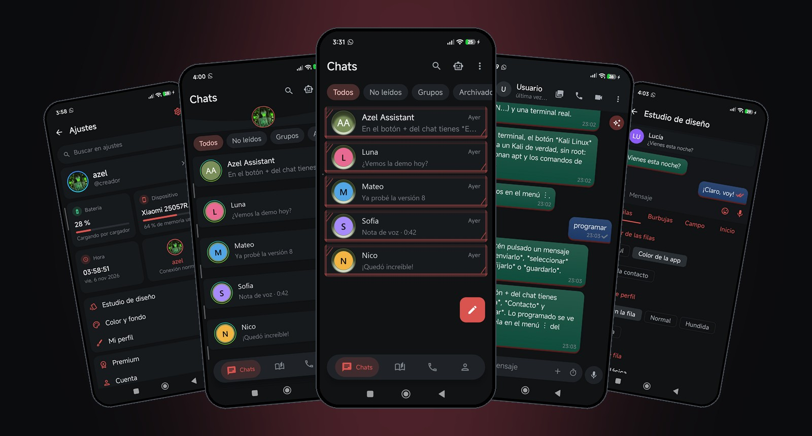

  

---

## Novedades de la 8.6

> **Versión actual: 8.6.0.** Historial completo en [CHANGELOG.md](CHANGELOG.md).

  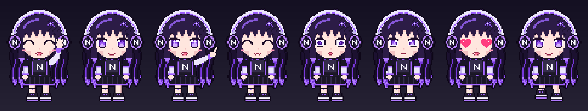

**Conoce a Nexa**
- 👋 Nexa es la anfitriona de NexusChat: una chibi en pixel art con melena violeta, cascos con la N y la chaqueta de la app.
- 🧭 Al crear tu cuenta **camina hasta cada botón de verdad**, lo ilumina, lo señala con un destello y te explica para qué sirve, en 27 paradas que recorren toda la app: chats, llamadas, historias, canales, difusiones, privacidad, notificaciones, tu perfil, Estudio de diseño, chats secretos, Tor, descargador de vídeos, terminal, editor de código y Azel.
- 🗣️ Habla con la voz del teléfono moviendo la boca, parpadea y cambia de expresión, con sus corazones, brillos, "?" y "!".
- 📚 Si la tocas te cuenta **más de 150 historias, curiosidades y consejos**: de Julio César y Enigma al primer SMS, de Sócrates a Camus. Y te presenta a su creador, Azelmodsx677.
- 📰 Es también el **centro de novedades**: después de cada actualización te cuenta lo nuevo. Puedes volver a llamarla desde Ajustes → Información.

**Marcas de enviado y leído con personalidad**

  

- 💤 **Ocho personajes en pixel art**, chicas y chicos, que duermen al enviar, despiertan y guiñan al entregar y ponen ojos de corazón al leer.
- ✨ 13 estilos nuevos de marcas y **Mis marcas**: pon tus propias imágenes o GIF para cada estado.
- ✅ La lista de chats muestra el **estado real** del último mensaje, con el nuevo estado de entregado (dos marcas grises).

**Actualizar sin sustos**
- 🧩 Si una actualización no encaja con la versión instalada, la app te dice por qué y te ayuda a resolverlo, en vez de mostrar "conflicto con un paquete".

---

## Novedades de la 8.5

**Archivos sin límites absurdos**
- 📎 Envía **hasta 30 fotos, vídeos o documentos a la vez**, cada uno con su descripción y menciones con @.
- 📄 Los documentos muestran su tipo y tamaño, **se renombran antes de enviarlos** y se abren dentro de la app.
- 🎞️ **GIF sin claves:** desde el teclado (Gboard, Xiaomi…), desde tu galería o convirtiendo un vídeo corto con "Enviar como GIF".

**Chats más rápidos**
- 🔗 Enlaces, correos y teléfonos en azul; escribe `*negrita*`, `_cursiva_`, `~tachado~` y `` `código` ``.
- ↩️ Desliza para responder, mantén pulsado para seleccionar y toca una respuesta para ir al mensaje original, aunque sea antiguo.
- 🗑️ Elimina para todos o solo para ti.

**Grupos y canales con control**
- 🛡️ Grupos donde **solo escriben los administradores** y tú decides quién edita la foto, el nombre y la descripción.
- 📣 Canales con foto, reacciones, contador de vistas, enlace para compartir y avisos silenciables; explora los más seguidos.
- 📨 **Difusiones:** un mensaje a muchos contactos, cada uno en su chat privado.

**Más privada que nunca**
- 🙈 Tu **correo y tu teléfono ya no son visibles** para otros usuarios. Quien ya los conoce puede encontrarte, pero nadie puede ver la lista.
- 🔐 Permisos de grupos y canales protegidos en el servidor: nadie se nombra administrador ni escribe en nombre de otro.

---

## Lo que trajo la 8

La 8 es la actualización en la que NexusChat deja de tener un aspecto y pasa a tener **el tuyo**. Cada cambio se aplica al momento, sin reiniciar y sin perder nada.

<table>
<tr>
<td align="center" width="25%">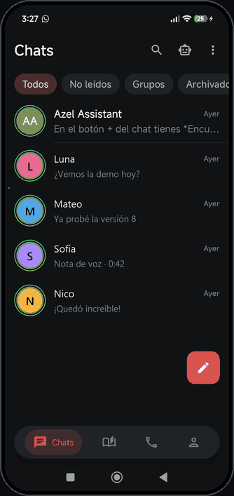 <strong>Filas</strong> Del 3D al neón, con la foto hundida o en esfera</td>
<td align="center" width="25%">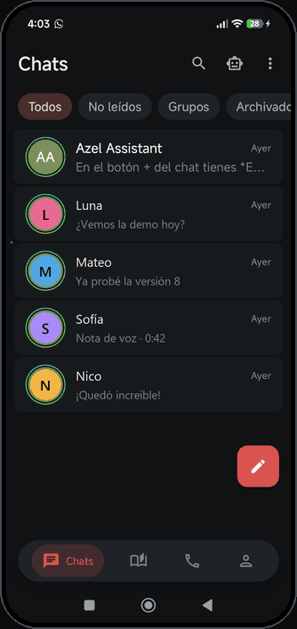 <strong>Inicio</strong> Tu foto, tu nombre, tu portada o una curva</td>
<td align="center" width="25%">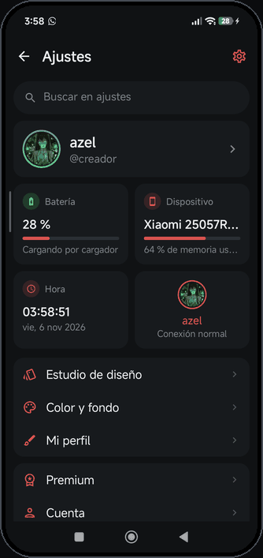 <strong>Ajustes</strong> Panel en vivo, tarjetas, lista o cuadrícula</td>
<td align="center" width="25%">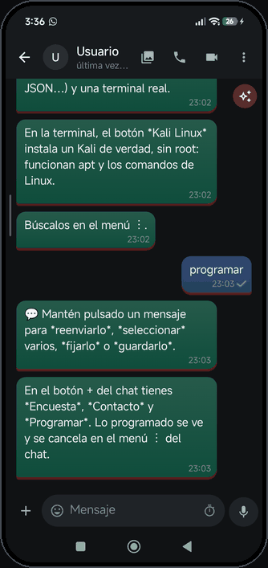 <strong>Campo de escribir</strong> Con tu foto, social, plano, 3D y más</td>
</tr>
</table>

- 🎨 **Estudio de diseño:** filas, burbujas, marcas de lectura, campo de escribir, inicio, ajustes y 8 barras inferiores, con vista previa.
- 🔐 **Grupos cifrados y chats secretos:** grupos de extremo a extremo con administradores y enlace de invitación, y chats secretos con una clave nueva en cada mensaje.
- 🎬 **Perfiles en vídeo:** foto y portada en movimiento de hasta 1 minuto y 30 segundos.
- ⚡ **Funciones rápidas:** un panel dentro del chat con los atajos a mano.
- 🗂️ **Chats a tu orden:** carpetas, chats ocultos tras tu huella, mensajes programados, marcar como no leído y exportar un chat a texto.
- 💬 **Conversaciones más claras:** respuestas con el nombre de quien escribió, etiqueta de reenviado, texto en fotos y vídeos, y notas de voz distintas de los audios.
- 😀 **Stickers junto a los emojis:** con favoritos, y también para responder historias.
- 👥 **Grupos con foto y descripción.**
- ⭕ **Aro animado en el campo de escribir:** tu foto dentro de un aro que gira y responde al toque.
- 🛡️ **Comunidad segura:** reporta usuarios desde su chat y consulta la política de privacidad dentro de la app.
- 📥 **Descargador de vídeos renovado:** se actualiza solo y reintenta si una web cambia.
- 🔎 **Búsqueda más rápida** y errores que dicen qué hacer, en tu idioma.
- 👀 **Quién reaccionó:** toca una reacción y ves cada persona con su emoji.
- 🙈 **Texto oculto:** escribe `||así||` y queda tapado hasta que lo toquen.
- 🤖 **Asistente al día:** te cuenta las novedades de la versión que tienes instalada.
- 🐉 **Kali Linux de verdad** dentro de la terminal.
- 🔠 **21 tipos de letra** para toda la app y **36 colores de acento**, o escribe el tuyo en hexadecimal.

---

## Por qué NexusChat

| | NexusChat | WhatsApp | Telegram | Signal |
|---|:---:|:---:|:---:|:---:|
| Cifrado de extremo a extremo en chats y grupos | ✅ | ✅ | Solo chats secretos | ✅ |
| Diseñar filas, campo, inicio, ajustes y barras | ✅ | ❌ | Solo temas | ❌ |
| Tor integrado | ✅ | Solo proxy | Solo proxy | Solo proxy |
| Registrarte sin número de teléfono | ✅ | ❌ | ❌ | ❌ |
| Tu correo y tu teléfono ocultos a los demás | ✅ | ❌ | Configurable | Configurable |
| Agentes de IA con tu propia clave | ✅ | Meta AI, sin elegir proveedor | Bots de terceros | ❌ |
| Terminal y Kali Linux | ✅ | ❌ | ❌ | ❌ |

Comparativa de funciones a noviembre de 2026. NexusChat está disponible por ahora solo para Android.

---

## Seguridad

| | Cómo lo protege NexusChat |
|---|---|
| Mensajes | Cifrado de extremo a extremo en chats de dos y grupos. El servidor guarda texto cifrado y una etiqueta, nunca el mensaje. |
| Vista previa del chat | También va cifrada; solo los participantes la leen. |
| Archivos | En un chat de dos, solo sus dos participantes pueden leer, subir o borrar sus archivos. |
| Enlaces internos | La app nunca muestra rutas del servidor en mensajes, stickers ni vistas previas. |
| Base de datos | Cada chat solo lo leen sus miembros, y los reportes no los puede leer nadie desde la app. |
| Registros | La versión publicada no escribe el contenido de los mensajes en el registro del sistema. |
| Datos personales | Tu correo y tu teléfono no se guardan en tu perfil público: solo un resumen cifrado para que quien ya los conoce pueda encontrarte. |
| Grupos y canales | Solo los administradores cambian miembros, permisos y datos del grupo; nadie puede enviar mensajes en nombre de otro. Lo comprueba el servidor, no la app. |
| Cuenta | Bloquear, reportar y eliminar tu cuenta desde la app. |

---

## El estudio de diseño

<table>
<tr>
<td width="38%" align="center">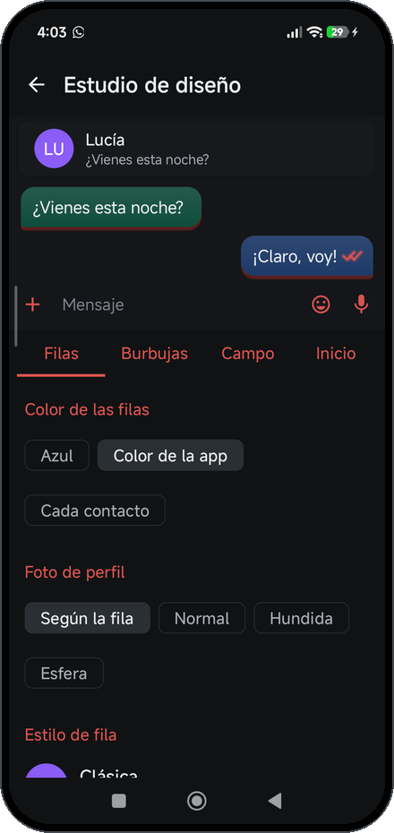</td>
<td width="62%" valign="middle">

### No son temas. Es tu app.

Otros mensajeros te dejan cambiar el fondo. Aquí eliges **cómo se construye cada pantalla**.

- **Cada opción con su miniatura:** ves lo que hace antes de elegirla.
- **Efecto de relieve real:** biseles, foto hundida y tarjetas 3D con canto que se inclinan al tocarlas.
- **Tu color en todas partes:** el acento se aplica a botones, filas, iconos y barras.
- **Búsqueda en ajustes:** escribe lo que buscas y llega al instante.

</td>
</tr>
</table>

### 10 filas de chat

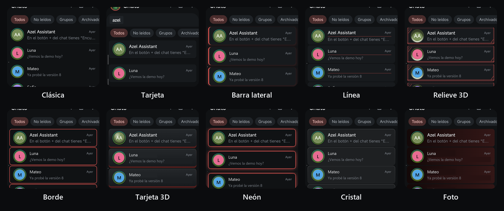

### 12 campos de escribir

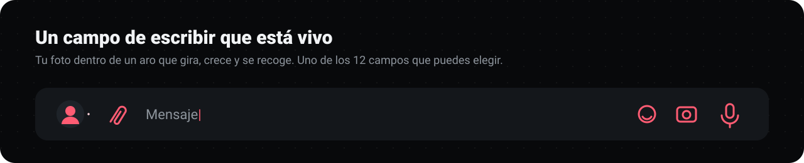

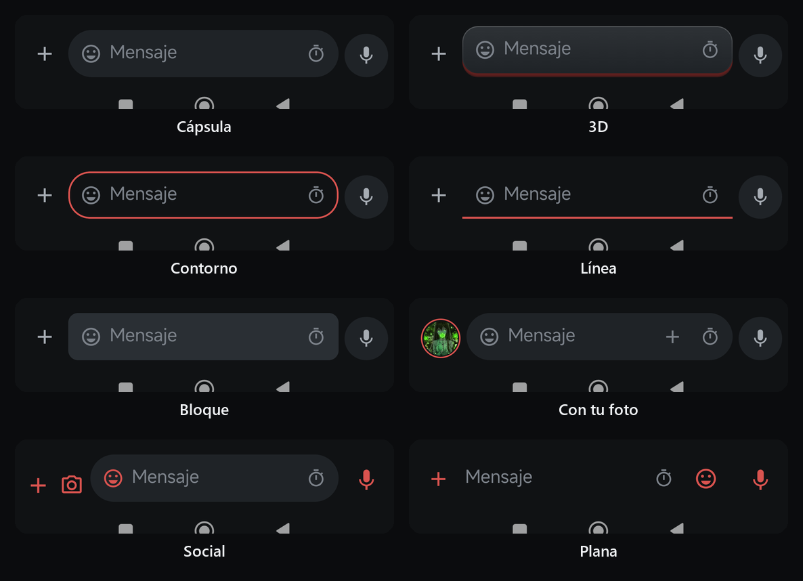

Además de estos ocho: foto con aro animado, foto cuadrada, cápsula central y marco con línea.

### 7 pantallas de inicio

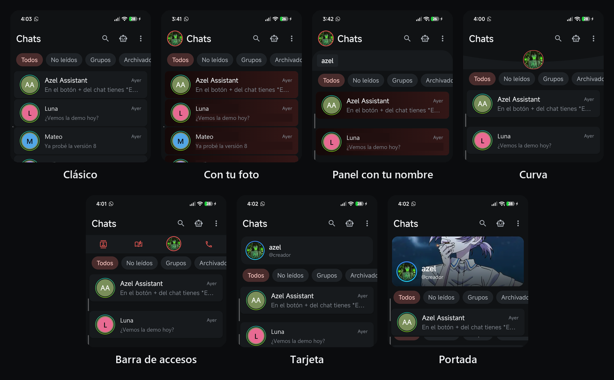

### 8 barras inferiores

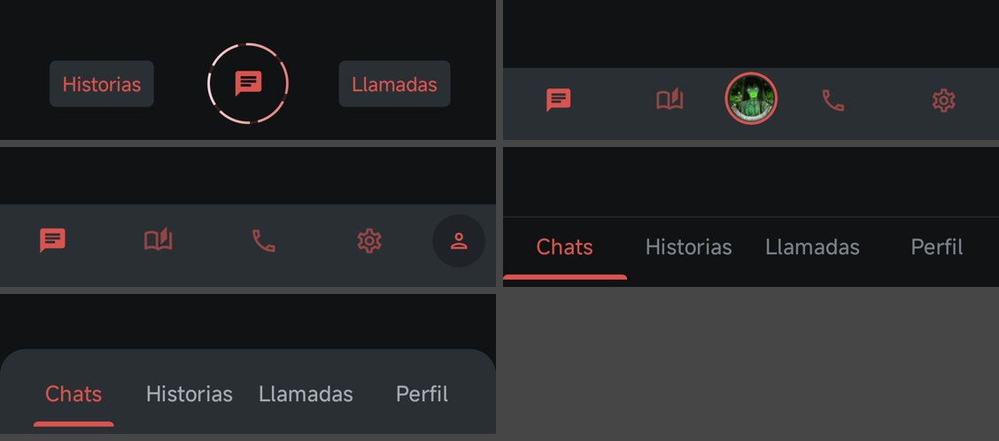

### 7 pantallas de ajustes

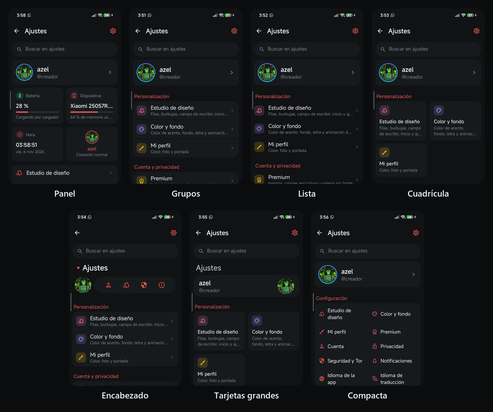

---

## Todo lo que trae

<table>
<tr>
<td width="50%"></td>
<td width="50%"></td>
</tr>
<tr>
<td>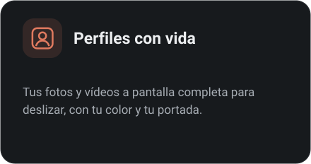</td>
<td></td>
</tr>
<tr>
<td>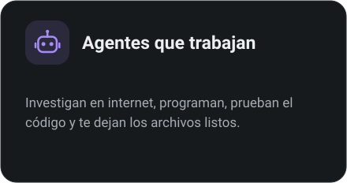</td>
<td>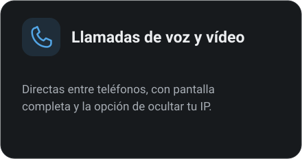</td>
</tr>
<tr>
<td>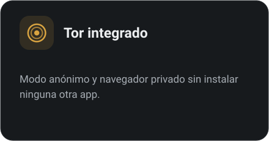</td>
<td></td>
</tr>
</table>

---

## Privacidad que se nota

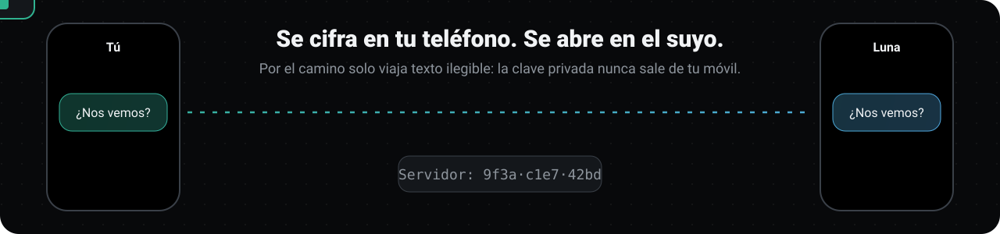

<table>
<tr>
<td width="30%" align="center">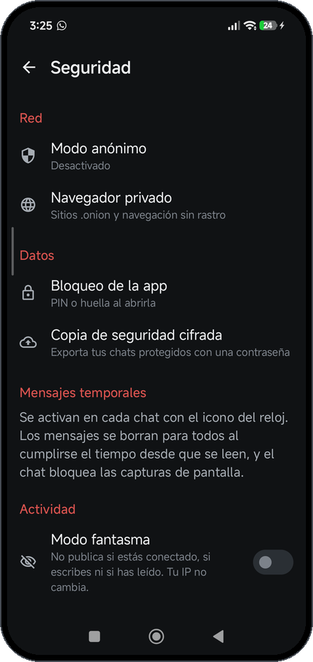</td>
<td width="70%" valign="middle">

- 🔒 **Cifrado de extremo a extremo** en chats y grupos. La clave privada nunca sale de tu teléfono.
- 🕵️ **Chats secretos** con una clave nueva en cada mensaje.
- 🧅 **Tor integrado** para navegar y conectarte de forma anónima, sin instalar nada más.
- 👻 **Modo fantasma:** no publica si estás conectado, si escribes ni si has leído.
- 🫣 **Chats ocultos** tras tu huella y **bloqueo de la app** con PIN o huella.
- ⏳ **Mensajes temporales** y de una sola vista.
- 💾 **Copias de seguridad cifradas** con tu contraseña.
- 🚫 **Sin anuncios.** Ninguno.

</td>
</tr>
</table>

---

## Agentes que hacen el trabajo

Le das un objetivo y **lo llevan hasta el final**: buscan, leen, programan, ejecutan, ven si falla, lo corrigen y te entregan el resultado. Y lo ves pasar en directo.


<table>
<tr>
<td width="62%" valign="top">

**Pídeles cosas como estas:**

- *"Crea una página web de tareas en HTML y guárdala en mis archivos."*
- *"Escribe en Python un programa que valide contraseñas, pruébalo y guárdalo."*
- *"Compara los 3 móviles más recomendados este año y dime cuál comprar."*
- *"Planifica un viaje de 4 días a Cartagena con presupuesto en pesos."*

**Lo que los hace distintos:**

- **Programan de verdad.** Ejecutan el código en 15 lenguajes, leen el error y lo arreglan antes de dártelo.
- **Buscan a fondo.** Consultan varios buscadores, abren las fuentes y citan de dónde sale cada dato.
- **Trabajan en equipo.** Un coordinador reparte las tareas entre arquitecto, programador, probador, investigador, analista y redactor.
- **Usan tu IA.** Gemini, OpenAI, OpenRouter, DeepSeek, Groq, Mistral o un modelo en tu ordenador. Tu clave se guarda cifrada en el teléfono.

</td>
<td width="38%" align="center" valign="top">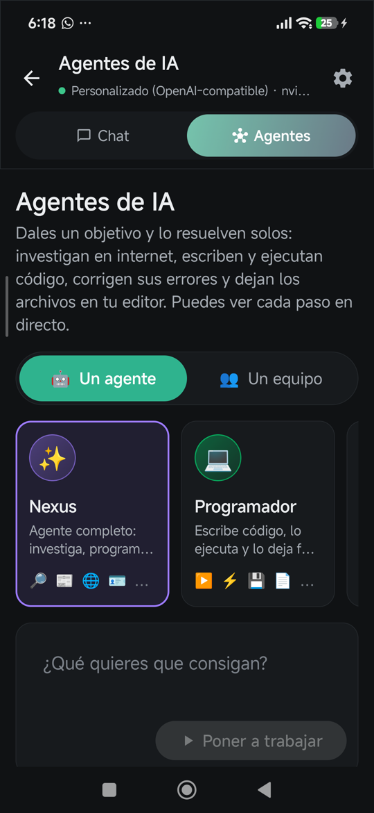</td>
</tr>
</table>

---

## Mucho más que un chat

<table>
<tr>
<td align="center" width="33%" valign="top">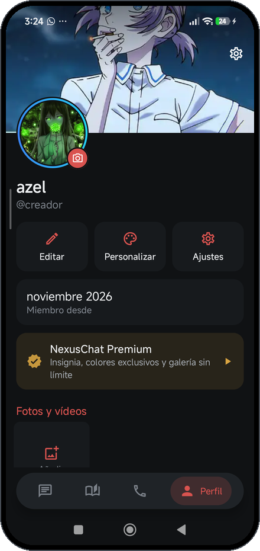 <strong>Tu perfil, tu escaparate</strong> Portada, foto en vídeo, galería a pantalla completa y 40 colores.</td>
<td align="center" width="33%" valign="top">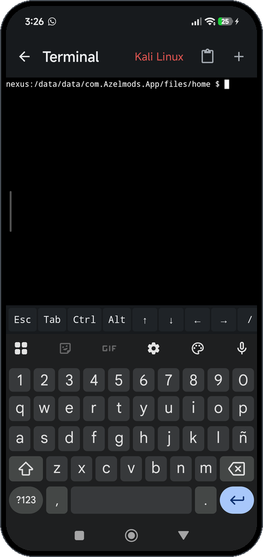 <strong>Terminal de verdad</strong> El shell de tu teléfono y Kali Linux, sin salir de la app.</td>
<td align="center" width="33%" valign="top">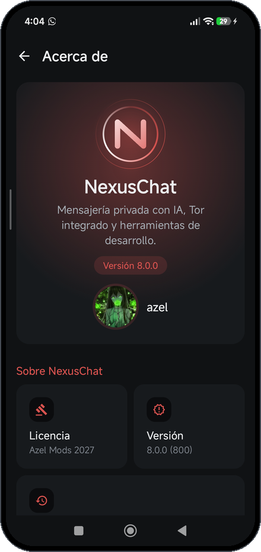 <strong>Cuidada hasta el final</strong> Hasta la pantalla de información tiene su propio diseño.</td>
</tr>
</table>

**Y además:** reacciones, respuestas, reenviar y seleccionar varios mensajes, encuestas, canales y difusiones, mensajes fijados y guardados, notas de voz, GIF, stickers propios y animados, vista previa de enlaces, menciones, compartir contactos, traducción y descarga de vídeos.

---

## Instálala en un minuto

1. Descarga el APK desde [la última versión](https://github.com/Azelmods677/NexusChat/releases/latest). Si no sabes cuál elegir, el **universal** funciona en todos los teléfonos; el **arm64-v8a** es más ligero y sirve para casi todos los actuales.
2. Ábrelo y permite la instalación desde esa fuente cuando Android lo pida.
3. Entra con tu correo, Google o tu número de teléfono.

Funciona en Android 12 o superior. Cuando sale una versión nueva, la propia app te avisa.

> **¿Vienes de la 8.4.1 o anterior?** Desde la 8.5 la app tiene una firma nueva: desinstala la versión anterior antes de instalar esta. Tus chats, grupos y canales siguen en tu cuenta.

> **Consejo para Xiaomi, Redmi, POCO, Huawei u Oppo:** para recibir tus avisos al instante, activa **Inicio automático** para NexusChat y pon su batería **Sin restricciones** en los ajustes del teléfono.

---

## Preguntas frecuentes

<strong>¿Es gratis?</strong>

 
Sí, y sin anuncios. Las funciones de IA usan la clave del proveedor que tú elijas, o ninguna si usas un modelo local.

<strong>¿Puedo usar el código de NexusChat?</strong>

 
No. El código se publica para que se pueda consultar, pero está protegido: copiarlo, modificarlo o publicar versiones propias requiere permiso de Azel Mods. Puedes instalar y usar libremente las versiones oficiales. Detalles en <a href="LICENSE">LICENSE</a>.

<strong>¿Dónde cambio el diseño?</strong>

 
En Ajustes → Estudio de diseño para filas, burbujas, campo de escribir, inicio y ajustes. En Ajustes → Color y fondo para el acento, el fondo y la letra.

<strong>¿Qué necesito para usar los agentes?</strong>

 
Una clave de un proveedor de IA. La de Google Gemini tiene un plan gratuito. Se configura en Ajustes → Inteligencia artificial.

<strong>¿Los agentes pueden tocar mis datos?</strong>

 
No acceden a tus chats. Pueden crear archivos en tu editor de código, pero nunca sobrescriben los que ya tenías: guardan una copia con otro nombre.

<strong>¿Necesito instalar Orbot para usar Tor?</strong>

 
No. Tor viene dentro de la app y se activa desde Ajustes → Seguridad y Tor.

---

<strong>Para desarrolladores</strong>

 

Android nativo con **Kotlin** y **Jetpack Compose**, arquitectura MVVM, **Firebase** (Auth, Realtime Database, Storage, Cloud Messaging y Cloud Functions), **WebRTC** para las llamadas y Tor integrado. El cifrado de los chats usa ECDH P-256 y AES-256-GCM.

El código se publica **solo para consulta**. Compilarlo, modificarlo o redistribuirlo requiere permiso de Azel Mods ([LICENSE](LICENSE)). Historial completo en [CHANGELOG.md](CHANGELOG.md).

**Documentación:** [documentación completa](docs/NexusChat-Documentacion-Completa.pdf), con el producto, sus decisiones técnicas y todo el código en 156 páginas. También por separado: [guía técnica](docs/NexusChat-Guia-Tecnica.pdf) y [referencia del código](docs/NexusChat-Referencia-Codigo.pdf).

---

## English

**NexusChat 8.6** is an Android messenger built for anonymity. You can sign up without a phone number, your email and phone are never visible to other users, and it combines end-to-end encrypted chats and groups, secret chats, voice and video calls, stories, AI agents that research, write and run code for you, built-in Tor and a real terminal with Kali Linux. On top of that sits a **design studio**: 10 chat rows, 12 message fields, 7 home screens, 7 settings screens, 8 bubble styles, 21 fonts and 36 accent colours, or your own. Version 8.5 adds sending up to 30 files at once, documents that open inside the app, admin-only groups, channels with reactions and views, broadcasts and keyless GIFs. Version 8.6 introduces Nexa, a pixel-art host who walks you through the real buttons of the app with voice and expressions and tells you what's new after every update, plus animated pixel characters for read receipts. No ads. The app is available in Spanish and English.

© 2026 Azel Mods. All rights reserved. The source code is published for viewing only; see [LICENSE](LICENSE).

[Download the latest version](https://github.com/Azelmods677/NexusChat/releases/latest) · Requires Android 12 or later.

---

  <strong>NexusChat</strong> está diseñada y desarrollada por <a href="https://github.com/Azelmods677"><strong>Azelmodsx677</strong></a>.  
  
  
  
    
  © 2026 Azel Mods. Todos los derechos reservados. Las capturas usan contactos de ejemplo. Condiciones de uso en <a href="LICENSE">LICENSE</a>.

